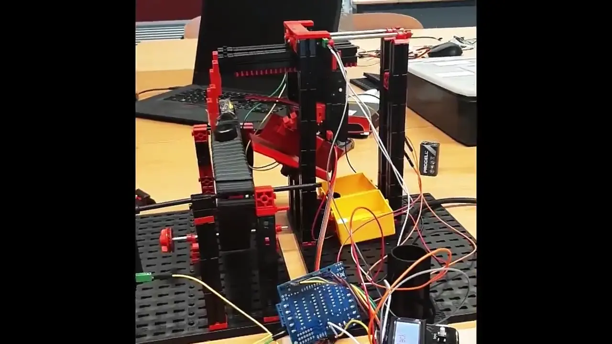

# Sorting robot simulation (Webots)

In the **DBL Embedded Systems** course at Eindhoven University of Technology (2022), our team of six built a Raspberry Pi robot that sorts black and white discs coming down a conveyor belt. Each colour has its own arm that pushes the disc off the belt, and green discs act as "unknown objects" that are let through. The user can choose to sort all discs, or only a chosen number of each colour.

My part was the **simulation**: a virtual copy of the robot in Webots, so we could test the sorting logic without needing the hardware. The Python code on the physical robot was written by my teammates, so it is not in this repository.

▶ A video of the real robot and the simulation side by side is on my [portfolio](https://AngelovaM2.github.io/#sorting-robot).

## What I did

- Modelled the robot's parts in Blender (frame, pistons, gears, motor body) and exported them as STL files for Webots.
- Built the simulated world with the conveyor belt, the two pushing arms and the discs.
- Wrote the controller in Java:
  - two simulated cameras read the colour of the disc in front of each arm,
  - linear motors push the disc off the belt,
  - position sensors tell the code when an arm has reached the end, so it can pull back and count the disc.
- Implemented both modes of the real robot, `SortAll` and `SortSome`, and a green light that turns on when a green disc passes.
- Ran experiments and did research together with the team.

## What is in this repository

| Path | What it is |
|---|---|
| `controllers/motorControllerWhite/motorControllerWhite.java` | The Java controller that runs the sorting logic |
| `worlds/Simulation.wbt` | The Webots world with the robot, belt and discs |
| `blender-parts/` | My Blender models (`.blend`) and the exported `.stl` files |

To run it, open `worlds/Simulation.wbt` in [Webots](https://cyberbotics.com/) and set the mode at the top of the controller (`"SortAll"` or `"SortSome"`, plus the number of discs wanted).

## What I would do differently

Webots did not let me use console input in our setup, and I kept everything in one main loop, so the two modes ended up as nested `if` statements. Today I would structure the controller as a proper state machine (waiting, pushing, returning, counting) and compare strings with `.equals()` instead of `==`. A nice difference with the real robot is that the simulated arms use position sensors as feedback, while the physical robot relied on fixed time delays.

---

Made by **Mariana Angelova** as part of a team of six · [Portfolio](https://AngelovaM2.github.io)
